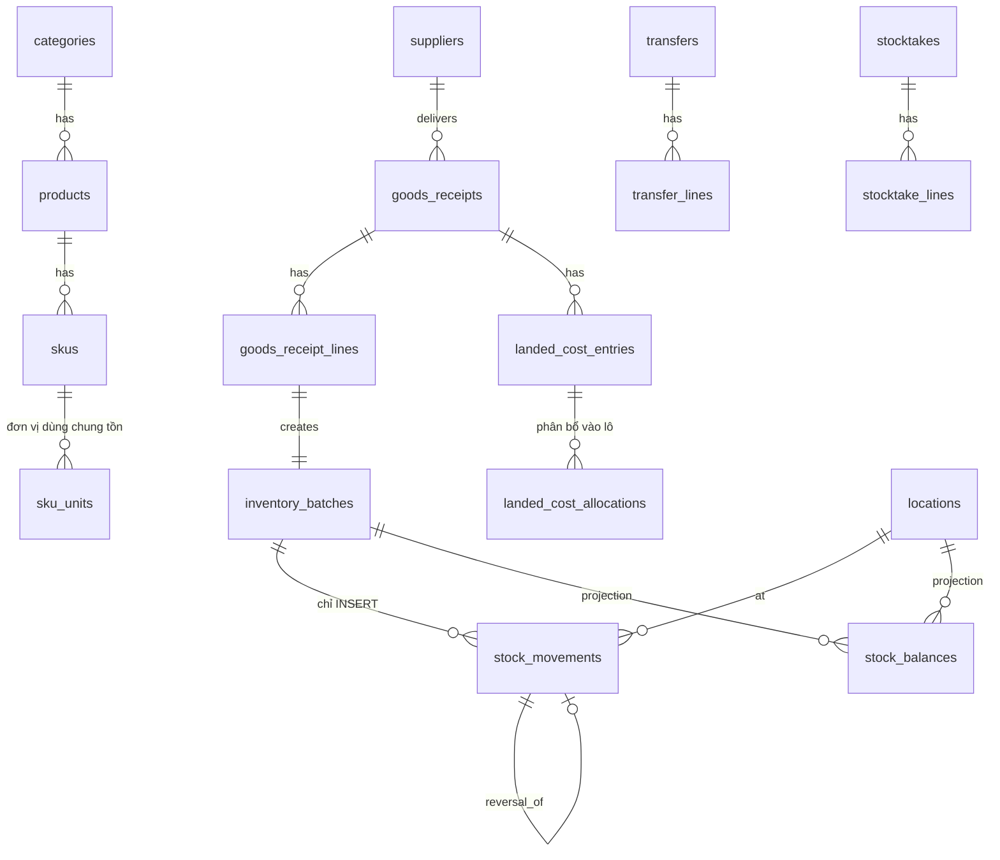
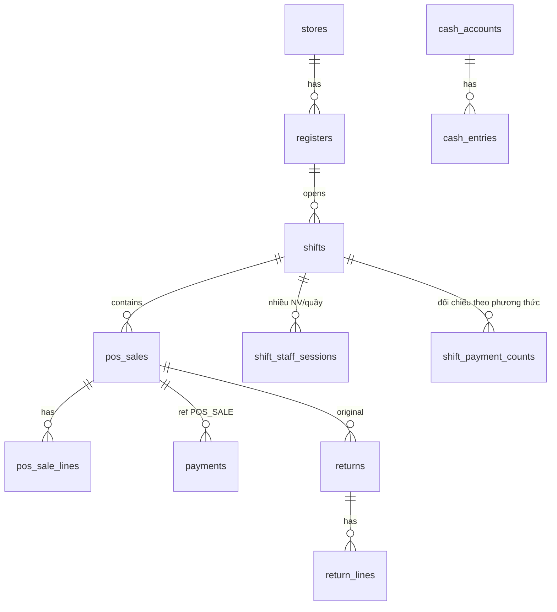
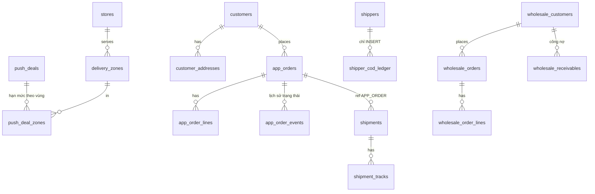

# ERD — Sơ đồ dữ liệu (CP01)

Nguồn: SPEC §12.1–§12.4, §10.5, §21.8 · ADR-003 (Prisma + `infra/sql`), ADR-005 (sổ kho), ADR-006 (schema/role/RLS),
ADR-007 (outbox/idempotency). Đây là **thiết kế**, chưa có migration chạy. Cột chi tiết lấy theo SPEC §12.2; bảng dưới
đây là danh mục đầy đủ + quan hệ chính + thứ tự migration.

## 1. Quy ước chung (§12.1)

- PK `id UUID` (UUID v7 sinh ở app; POS offline sinh `client_txn_id` v7). Bảng nối dùng PK ghép.
- Tiền `BIGINT` (`*_amount`, `*_price`, `*_per_kg`, `*_per_unit`); gram `INTEGER` (`*_g`); số đếm `INTEGER`
  (`*_units`); `CHECK (x >= 0)` trừ cột cho phép âm (đảo bút toán `qty_g`, `variance_*`, `rounding_amount`).
- `TIMESTAMPTZ` cho mốc thời gian (UTC); `business_date DATE` theo Asia/Ho_Chi_Minh, mốc 04:00.
- Danh mục: `archived_at` thay vì xóa. Chứng từ: cột chung `status, completed_at, completed_by, cancelled_at,
  cancelled_by, cancel_reason` (§21.3.2). Khóa lạc quan: `version INTEGER` trên đơn, tồn, mặt hàng đẩy.
- PII (`phone_enc`, `address_enc`, `receiver_phone_enc`, `totp_secret_enc`) = `BYTEA` mã hóa ứng dụng
  (`PII_ENC_KEY`); tra cứu bằng `*_hash` (HMAC với `PII_HASH_PEPPER`), index unique theo hash.
- Mã hiển thị `code` UNIQUE, sinh qua `code_sequences` (§21.3.14).

## 2. Danh mục bảng

Cột "Mig" = nhóm migration (mục 4). Module chủ = module NestJS duy nhất được ghi (ADR-002).

### 2.1. Schema `core` — §12.2 (76 bảng)

| Bảng | Module chủ | Quan hệ chính | Mig |
|---|---|---|---|
| users | auth | — ; + totp_last_step (chống dùng lại TOTP — ADR-021, migration 0002) | M02 |
| staff | auth | users | M02 |
| user_role_assignments | rbac | users; scope → stores/warehouses | M02 |
| approval_limits | rbac | — | M02 |
| sessions | auth | users, pos_devices (FK thêm ở M03); + family_id, step_up_until, amr (ADR-012) | M02 |
| viewer_profiles | publish | store_ids[] → stores | M02 |
| viewer_profile_assignments | publish | users, viewer_profiles | M02 |
| stores | catalog (tổ chức) | — | M03 |
| warehouses | catalog (tổ chức) | — | M03 |
| locations | inventory | stores \| warehouses | M03 |
| registers | pos | stores | M03 |
| devices | pos | stores, registers | M03 → **CP07** (quản lý thiết bị đi cùng POS) |
| pos_devices | auth | stores, registers, users(activated_by); + public_key, status (ADR-012) | M03 |
| pos_enrollment_codes | auth | stores, users(created_by), pos_devices(used_by_device_id); code_hash, hạn ≤ 1 giờ, dùng một lần (ADR-022, NC-20) | M03 |
| categories | catalog | categories(parent) | M04 |
| products | catalog | categories | M04 |
| skus | catalog | products | M04 |
| store_prices | pricing | stores, skus | M04 |
| price_change_logs | pricing | skus | M04 |
| bundle_templates | catalog | skus | M04 → **CP17** (dùng ở lắp giỏ) |
| bundle_items | catalog | bundle_templates, skus | M04 → **CP17** |
| processing_recipes | catalog | skus | M04 → **CP17** |
| processing_recipe_inputs | catalog | processing_recipes, skus | M04 → **CP17** |
| suppliers | purchasing | — ; + supplier_skus. Danh bạ cơ bản làm ở **M04/CP04** (NC-27); `phone_hash` index THƯỜNG (hai NCC được trùng SĐT liên hệ) | M04 |
| goods_receipts | purchasing | suppliers, warehouses | M05 |
| goods_receipt_lines | purchasing | goods_receipts, skus, inventory_batches | M05 |
| landed_cost_entries | purchasing | goods_receipts, landed_cost_types | M05 |
| landed_cost_allocations | purchasing | landed_cost_entries, inventory_batches | M05 |
| supplier_returns | purchasing | suppliers, goods_receipts | M05 |
| supplier_payables | purchasing | suppliers, goods_receipts | M05 |
| inventory_batches | inventory | skus, suppliers, goods_receipt_lines; parent_batch_ids[] | M05 |
| stock_movements | inventory | locations, inventory_batches, skus; reversal_of_id → stock_movements | M06 |
| stock_balances | inventory | PK(location_id, batch_id, sku_id) | M06 |
| stock_reservations | inventory | locations, skus; ref_line_id đa hình | M06 |
| transfers | inventory | locations(from/to) | M06 |
| transfer_lines | inventory | transfers, inventory_batches, skus | M06 |
| stocktakes | inventory | locations | M06 |
| stocktake_lines | inventory | stocktakes, skus, inventory_batches | M06 |
| spoilage_logs | inventory | locations, inventory_batches | M06 |
| ripeness_checks | inventory | inventory_batches, locations | M17 |
| markdowns | pricing | inventory_batches, locations; proposed_by ≠ approved_by | M07 (tạo sớm vì pos_sale_lines tham chiếu) |
| processing_orders | inventory | processing_recipes, locations, inventory_batches(output) | M17 |
| processing_order_inputs | inventory | processing_orders, inventory_batches | M17 |
| shifts | pos | stores, registers, staff(cashier) | M07 |
| day_closes | pos | stores; UNIQUE(store_id, business_date, version) | M07 |
| cash_movements | pos | shifts, stores | M07 |
| pos_sales | pos | stores, registers, shifts; UNIQUE(client_txn_id) | M07 |
| pos_sale_lines | pos | pos_sales, skus, devices(scale), markdowns | M07 |
| payments | payments | ref_type/ref_id đa hình (POS_SALE\|APP_ORDER\|WHOLESALE) | M08 |
| refunds | payments | ref đa hình, files(proof) | M08 |
| unmatched_bank_txns | payments | — | M08 |
| customers | app-orders | users | M13 |
| customer_addresses | app-orders | customers, delivery_zones | M13 |
| customer_devices | notify | customers | M13 |
| store_follows | app-orders | customers, stores (dành cho H1 — hoãn) | M13 |
| delivery_zones | delivery | stores; `area geography(MultiPolygon,4326)` GIST | M13 |
| delivery_slots | delivery | delivery_zones | M13 |
| push_deals | push-deals | skus; batch_ids[] | M13 |
| push_deal_zones | push-deals | push_deals, delivery_zones | M13 |
| notifications_campaigns | notify | push_deals, files | M13 |
| notification_deliveries | notify | notifications_campaigns, customers, customer_devices | M13 |
| app_orders | app-orders | customers, delivery_zones, stores, delivery_slots | M14 |
| app_order_lines | app-orders | app_orders, push_deals, skus, files(scale_photo) | M14 |
| app_order_events | app-orders | app_orders (chỉ INSERT) | M14 |
| complaints | app-orders | app_orders, customers | M14 |
| shippers | delivery | users, stores | M15 |
| shipments | delivery | ref đa hình (APP_ORDER\|WHOLESALE), shippers | M15 |
| shipment_tracks | delivery | shipments | M15 |
| shipper_cod_ledger | delivery | shippers, shipments (chỉ INSERT) | M15 |
| wholesale_customers | wholesale | wholesale_price_lists | M16 |
| wholesale_price_lists | wholesale | — | M16 |
| wholesale_price_items | wholesale | wholesale_price_lists, skus | M16 |
| wholesale_orders | wholesale | wholesale_customers, locations | M16 |
| wholesale_order_lines | wholesale | wholesale_orders, skus | M16 |
| wholesale_receivables | wholesale | wholesale_customers, wholesale_orders (chỉ INSERT) | M16 |
| files | files | owner đa hình; index THƯỜNG trên sha256 (trùng chỉ cảnh báo, FR-INV-16); device_id FK thêm ở M03; status PENDING/READY/REJECTED (ADR-014) | M02 |
| period_locks | publish | — | M12 |

### 2.2. Schema `core` — bổ sung §21.8 (20 bảng)

| Bảng | Module chủ | Quan hệ chính | Mig |
|---|---|---|---|
| units | catalog | — | M04 |
| sku_units | catalog | skus, units | M04 |
| sku_default_locations | inventory | stores, skus, locations | M04 |
| barcode_rules | catalog | — | M04 |
| code_sequences | (shared) | PK(doc_type, scope_key, period) — scope = cửa hàng/máy, period = ngày (§21.3.14) | M02 |
| landed_cost_types | purchasing | — | M05 |
| supplier_prices | purchasing | suppliers, skus | M18 |
| purchase_orders | purchasing | suppliers, warehouses | M18 |
| purchase_order_lines | purchasing | purchase_orders, skus | M18 |
| reorder_rules | inventory | locations, skus | M18 |
| internal_use_logs | inventory | locations, inventory_batches | M06 |
| store_lock_dates | publish | stores | M08 |
| staff_badges | auth | staff; `badge_code_hash` | M09 |
| shift_staff_sessions | pos | shifts, staff | M09 |
| shift_payment_counts | pos | shifts | M08 |
| returns | pos | pos_sales(original) | M09 |
| return_lines | pos | returns, pos_sale_lines | M09 |
| cash_accounts | pos | stores (nullable = văn phòng/ngân hàng) | M09 |
| cash_entries | pos | cash_accounts; ref đa hình | M09 |
| import_jobs | catalog | files | M04 |

Cột bổ sung §21.8: `inventory_batches.alert_date, stop_sell_app_date`; `stock_movements.reversal_of_id`; enum
`movement_type` thêm `INTERNAL_USE`, `OPENING_BALANCE`. Đơn điện thoại dùng `app_orders.channel = PHONE` (thêm cột
`channel` enum `APP|PHONE`).

### 2.3. Schema `reporting` (§12.3, §10.5)

| Bảng | Ghi | RLS viewer | Ghi chú |
|---|---|---|---|
| live_sales_hourly | projector_rw | có | không có cột giá vốn (NC-10) |
| live_sales_hourly_cost | projector_rw | viewer bị REVOKE | giá vốn theo giờ, chỉ Master đọc (NC-10) |
| live_store_status | projector_rw | có | |
| live_orders | projector_rw | có | `customer_masked`, không PII |
| live_stock | projector_rw | có | chỉ số lượng; bắt buộc `store_id` (kho tổng không hiện cho viewer) |
| daily_revenue | projector_rw | có | R03 |
| snapshots | API publish (owner function) | có | chỉ INSERT + chuyển status bằng function |
| snap_sales, snap_inventory, snap_purchase, snap_price_spread, snap_delivery, snap_pnl | API publish | có | chỉ INSERT (trigger) |
| standard_cost_matrix | Master | viewer bị REVOKE | |

Function `reporting.allowed_stores(profile_id uuid) RETURNS uuid[]` (SECURITY DEFINER, đọc bản sao hồ sơ trong
`reporting.viewer_profile_scopes` — **đề xuất thêm** để viewer không cần đọc `core.viewer_profiles`).

Đã quyết (NC-10, Tiến duyệt 2026-11-17): `live_sales_hourly` KHÔNG có `cogs_amount` (lệch §12.3 có chủ đích, vì FR-INV-11) →
giá vốn nằm ở `reporting.live_sales_hourly_cost`, chỉ `projector_rw` ghi, chỉ Master (`app_rw`) đọc; `viewer_ro` bị REVOKE.

### 2.4. Schema `audit`, `integration`

| Bảng | Ghi | Ghi chú |
|---|---|---|
| audit.logs, audit.export_logs | app_rw (INSERT trong cùng transaction nghiệp vụ, ADR-011) | chỉ INSERT (trigger + REVOKE) |
| audit.login_logs | audit_writer | chỉ INSERT |
| audit.viewer_access | viewer_act | chỉ INSERT; snapshot_id FK thêm ở M12 |
| integration.outbox | app_rw (INSERT), worker (UPDATE `published_at`, `attempts`) | ADR-007 |
| integration.processed_events | worker | PK(consumer, event_id) |
| integration.webhook_inbox | app_rw | UNIQUE(provider, external_id) |
| integration.external_calls | app_rw, worker | không lưu secret/token trong request/response |
| integration.idempotency_keys | app_rw | **thêm theo ADR-007**; PK(scope, key) |
| integration.sql_migrations | owner | tạo trong `000_bootstrap.sql` (ADR-017) |

## 3. Sơ đồ quan hệ chính

### 3.1. Danh mục, mua hàng, kho

### 3.2. POS & thanh toán

### 3.3. App, mặt hàng đẩy, giao hàng, sỉ

## 4. Thứ tự migration (M01–M02 đã chạy; cách áp: ADR-020)

Prisma tạo bảng theo nhóm; SQL tay (CHECK, trigger, GRANT, RLS, seed) nhúng cuối `migration.sql` của mỗi nhóm
(`apps/api/prisma/migrations/NNNN_<tên>/`); `infra/sql` chỉ còn phần trước Prisma. Cột "infra/sql" dưới đây từ M03 trở
đi là tên gợi ý cho phần SQL tay, không còn là file riêng (ADR-020).

**M02 đã làm (CP03 lát 1, `0001_foundation`):** users, recovery_codes, staff, staff_badges, permissions,
role_permissions, user_role_assignments, user_permission_grants, approval_limits, sessions, refresh_tokens,
auth_challenges, otp_challenges, viewer_profiles(+assignments), `reporting_private.viewer_profile_scopes`, files,
`audit.logs/login_logs/export_logs/viewer_access`, `integration.outbox/processed_events/idempotency_keys` + M03 tối thiểu
(stores, warehouses, registers, pos_devices — CP04 mở rộng). `code_sequences` chuyển CP07. Thêm
`infra/sql/001_extension_privileges.sql`.

**CP04 lát 1 (`0009_catalog`):** M04 + mở rộng M03 (stores §4.6: tọa độ, giờ mở, `pos_status`, `app_status`, năng lực;
registers.name; locations) + units, categories, products, skus, sku_units, store_prices, price_change_logs,
sku_default_locations, barcode_rules, import_jobs, reason_codes, container_types, brand_settings, suppliers, supplier_skus.
Lệch so với §12.2 (đã quyết ở lát 1):
- **Mã vạch chỉ ở `sku_units.barcode`** (unique toàn cục khi chưa lưu trữ; cấm 13 số bắt đầu bằng 2 — dải tem cân), không có
  `skus.barcode`: một chỗ thì unique được bằng index, tránh trùng chéo hai bảng.
- **Chưa có `images`** ở products/skus — ảnh app làm ở CP13 qua `file_links` (§6.1).
- **Kiểu bán, mã SKU, hệ số quy đổi, mã đơn vị bất biến** (quyền theo cột): đổi = tạo mới + lưu trữ bản cũ. Danh mục **không
  xóa** (app_rw không có DELETE) — chỉ lưu trữ.
- **Giá có lịch sử bắt buộc:** constraint trigger hoãn tới COMMIT đối chiếu giá hiện hành (skus / sku_units / store_prices)
  với bản ghi `price_change_logs` mới nhất cùng khóa (sku, cửa hàng, loại giá, đơn vị); bản đầu `old_value NULL`, mỗi bản
  sau `old_value` = `new_value` bản trước; `changed_at = clock_timestamp()` lấy sau khóa advisory `price:<khóa>`. Đọc
  theo `ORDER BY changed_at DESC, id DESC` (`core.price_log_latest()`); `changed_at` tăng nghiêm ngặt theo khóa giá
  (`GREATEST(clock_timestamp(), bản trước + 1 µs)`). Log mà giá thật không đổi cũng bị rollback lúc COMMIT. Giá thực thu luôn là giá chụp trên dòng bán.
- **Kho tổng + vị trí mặc định (§19.7) không seed** — API lát 4 tạo khi tạo kho / cửa hàng (cùng transaction, gồm một vị trí
  `IN_TRANSIT`) và bù cho cửa hàng có từ CP03.
- Trần giá 1 tỷ đồng mọi cột giá; PLU 5 số khác `00000`, unique trong SKU chưa lưu trữ.
- Đơn vị thùng/sọt có `factor_g` cứng vẫn tạo được để mua; **CP05 quy định nhận hàng luôn cân** (§5.3, §21.3.1) — hệ số chỉ
  để ước lượng đặt hàng. "Túi 1 kg" (đơn vị đếm, 1000 g) được giá riêng; đơn vị `KG` thì dùng giá/kg của SKU.
Khóa mới: advisory `catalog:category_tree` (đổi cha danh mục; chỉ READ COMMITTED), `price:<sku>:<cửa hàng>:<loại>:<đơn vị>`
(ghi lịch sử giá) — lấy SAU khóa dòng giá tương ứng.

**CP03 sau lát 1:** pos_enrollment_codes (0003, ADR-022), files.final_key (0006), users.must_change_password (0007,
NC-22), auth_lockouts + sessions.reauth_failed_count (0008, ADR-030 — khóa theo (tài khoản, nguồn)). Thứ tự khóa xác
thực: advisory `auth:<user_id>` → `core.users` → `core.sessions` (ORDER BY id) → `core.pos_devices`; `auth_lockouts` chỉ
được khóa bên trong khóa `auth:<user_id>`.

| Nhóm | CP | Prisma | infra/sql |
|---|---|---|---|
| M01 nền | CP02 | — | `000_bootstrap.sql` (extension postgis, pgcrypto, pg_trgm, unaccent; schema core/reporting/reporting_private/audit/integration; role theo ADR-011, KHÔNG default privilege cho viewer; REVOKE EXECUTE FROM PUBLIC; `integration.sql_migrations`; `raise_immutable()`) — các nhóm sau nhúng SQL tay trong `migration.sql` của Prisma (ADR-017) |
| M02 người dùng, phiên, file, mã | CP03 | users, staff, sessions, user_role_assignments, approval_limits, viewer_profiles(+assignments), files, code_sequences, audit.*, integration.* | `010_audit_append_only.sql` · `011_integration_unique.sql` |
| M03 tổ chức | CP03/CP04 | stores, warehouses, locations, registers, pos_devices (**đã làm**: 0001 + 0009); devices → CP07 | — |
| M04 danh mục | CP04 | **đã làm (0009)**: categories, products, skus, units, sku_units, sku_default_locations, store_prices, price_change_logs, barcode_rules, import_jobs, reason_codes, container_types, brand_settings, suppliers, supplier_skus; bundle_*, processing_recipe* → CP17 | — |
| M05 mua hàng & lô | CP05 | suppliers, landed_cost_types, goods_receipts(+lines), landed_cost_entries/allocations, supplier_returns, supplier_payables, inventory_batches | — |
| M06 sổ kho | CP06 | stock_movements, stock_balances, stock_reservations, transfers(+lines), stocktakes(+lines), spoilage_logs, internal_use_logs | `020_stock_movements_immutable.sql` · `021_stock_checks.sql` (kho tổng không âm) |
| M07 POS lõi | CP07 | markdowns, shifts, day_closes, cash_movements, pos_sales, pos_sale_lines, sale_line_batch_allocations | `030_pos_client_txn_unique.sql` |
| M08 thanh toán, ca | CP08 | payments, refunds, unmatched_bank_txns, shift_payment_counts, store_lock_dates | `031_lock_date_guard.sql` |
| M09 POS mở rộng | CP09 | staff_badges, shift_staff_sessions, returns(+lines), cash_accounts, cash_entries | — |
| M10 reporting live | CP10 | reporting.live_*, live_sales_hourly_cost, daily_revenue, reporting_private.viewer_profile_scopes | grant/RLS theo ADR-011 |
| M11 (không dùng) | — | — | giữ số để khớp CP |
| M12 snapshot, viewer | CP12 | reporting.snapshots, snap_*, standard_cost_matrix, period_locks | `041_snapshots_immutable.sql` · `042_viewer_rls.sql` · `043_allowed_stores_fn.sql` |
| M13 vùng giao, deal, thông báo | CP13 | customers, customer_addresses, customer_devices, store_follows, delivery_zones, delivery_slots, push_deals, push_deal_zones, notifications_* | `050_zones_gist.sql` (geography + GIST) |
| M14 đơn app | CP14 | app_orders(+channel), app_order_lines, app_order_events, complaints | `051_app_order_events_append_only.sql` |
| M15 giao hàng | CP15 | shippers, shipments, shipment_tracks, shipper_cod_ledger | `052_cod_ledger_append_only.sql` |
| M16 sỉ | CP16 | wholesale_* | `053_receivables_append_only.sql` |
| M17 độ chín, sơ chế, lắp giỏ | CP17 | ripeness_checks, processing_orders(+inputs, kind PROCESS/PACK/ASSEMBLE) | — |
| M18 PO, bổ sung | CP18 | supplier_prices, purchase_orders(+lines), reorder_rules | — |

Nguyên tắc: mỗi migration có rollback (`down`) hoặc ghi rõ phần không đảo được; không migration phá hủy dữ liệu khi
chưa có lệnh của Tiến.

## 5. Index & ràng buộc bắt buộc (§12.4 + đề xuất)

- `stock_movements(batch_id, location_id, created_at)`, `(business_date, location_id)`; trigger chỉ-thêm.
- `stock_balances` PK `(location_id, batch_id, sku_id)`; `CHECK` theo loại vị trí (kho tổng ≥ 0) qua trigger.
- `pos_sales(client_txn_id)` UNIQUE; `pos_sales(store_id, business_date)`.
- `push_deals`: cập nhật `sold_g` bằng `UPDATE … WHERE sold_g + $1 <= quota_g RETURNING` (không dựa Redis).
- `delivery_zones` GIST(area); `customer_addresses` GIST(location).
- `webhook_inbox` UNIQUE(provider, external_id); `processed_events` PK(consumer, event_id).
- `inventory_batches(sku_id, expiry_date)` cho FEFO; partial index `WHERE status = 'ACTIVE'`.
- `app_orders(store_id, status)`, `app_orders(customer_id, placed_at DESC)`.

## 6. Sửa theo review CP01 (2026-11-17) — ràng buộc chống ghi trùng, bán quá, sai quyền

### 6.1. Cột/bảng bổ sung
| Đối tượng | Bổ sung | Lý do |
|---|---|---|
| `stock_movements` | `source_line_id`; `UNIQUE(source_type, source_id, source_line_id, movement_type, batch_id, location_id) WHERE reversal_of_id IS NULL`; `UNIQUE(reversal_of_id)`; trigger BEFORE INSERT: bút toán đảo phải cùng lô/vị trí/`unit_cost`, `qty` trái dấu; CHECK dấu theo `movement_type`; loại `COST_ADJUST` (qty 0, chỉ `cost_amount`) cho lô "chờ giá" | FR-INV-05/09, ADR-005 |
| `stock_availability(location_id, sku_id, app_eligible_g, app_eligible_units, reserved_g, reserved_units, version)` — **mới** | giữ tồn bằng `UPDATE … WHERE app_eligible_g - reserved_g >= $1 RETURNING`; `app_eligible` loại lô qua `stop_sell_app_date` | FR-INV-09/20 |
| `stock_reservations` | `UNIQUE(ref_type, ref_line_id) WHERE status = 'ACTIVE'`; index `(location_id, sku_id) WHERE status='ACTIVE'`, `(expires_at) WHERE status='ACTIVE'` | không giữ hai lần |
| `push_deals` | `CHECK (num_nonnulls(quota_g, quota_units) = 1)`, `CHECK (sold_g BETWEEN 0 AND quota_g)`, `CHECK (sold_units BETWEEN 0 AND quota_units)` | FR-INV-09 |
| `push_deal_zones` | cùng CHECK; trừ trong cùng transaction sau `push_deals` | §7.3 hạn mức theo vùng |
| `push_deal_customer_usage(push_deal_id, customer_key_hash, used_g, used_units)` — **mới** | PK; `UPDATE … WHERE used + $1 <= limit RETURNING`; key = hash(SĐT) (F9 §14) | giới hạn mỗi khách |
| `sale_line_batch_allocations(line_type, line_id, batch_id, qty_g, qty_units, unit_cost_per_kg, cost_amount BIGINT)` — **mới** | thay `batch_allocations jsonb` của dòng POS/app/sỉ | FR-INV-01 (không tiền trong jsonb) |
| `supplier_return_lines`, `complaint_lines` — **mới** | thay `lines jsonb` | FR-INV-01 |
| Dòng bán/mua (`pos_sale_lines`, `app_order_lines`, `wholesale_order_lines`, `goods_receipt_lines`, `purchase_order_lines`, `return_lines`, `supplier_return_lines`) | `sku_unit_id`, `unit_qty`, `base_qty_g`, `base_qty_units`; FK composite `(sku_unit_id, sku_id)` → `sku_units(id, sku_id)` | §21.3.1, T26 |
| `skus` | `alert_days_before_expiry`, `stop_app_days_before_expiry`; `inventory_batches` CHECK `alert_date <= expiry_date AND stop_sell_app_date <= expiry_date` | §21.3.7 |
| Chứng từ kho/mua (`goods_receipts`, `supplier_returns`, `transfers`, `stocktakes`, `spoilage_logs`, `internal_use_logs`, `processing_orders`) | `created_by`, `status`, `submitted_at`, `completed_at/by`, `approved_by`, `cancelled_at/by`, `cancel_reason`; trigger chặn sửa khi khác `DRAFT`; DELETE chỉ `DRAFT` của người tạo; `CHECK (status <> 'CANCELLED' OR (cancelled_by IS NOT NULL AND cancel_reason IS NOT NULL))`; `spoilage_logs.stocktake_id` (T30) | FR-INV-07, §21.3.2 |
| Người tạo ≠ người duyệt | `CHECK (approved_by IS NULL OR approved_by <> created_by)` trên `spoilage_logs`, `internal_use_logs`, `stocktakes`, `cash_movements`, `refunds`, `markdowns(proposed_by)`; `pos_sale_lines.staff_id` (`discount_approved_by` bỏ — NC-21 không còn giảm giá tay; CP07); `shifts.variance_approved_by` | FR-INV-14 |
| `payments`, `refunds`, `shipments`, `cash_entries` | exclusive arc: `pos_sale_id`, `app_order_id`, `wholesale_order_id` nullable + `CHECK (num_nonnulls(...) = 1)` thay cho `ref_type/ref_id`; `payments`: `UNIQUE(provider_txn_id)`, `UNIQUE(sepay_va) WHERE status IN ('PENDING','UNKNOWN')`, `va_status` tách khỏi `status`; `refunds`: khóa nguồn duy nhất (`complaint_id` / `payment_id`) | toàn vẹn tiền |
| `app_orders` | `CHECK (refunded_amount <= paid_amount)`; `channel APP\|PHONE`, `fulfillment_type DELIVERY\|PICKUP`, `zone_id` nullable khi PICKUP, `pickup_at`, `tracking_token_hash`; `business_date`, `device_occurred_at`, `is_late_posted` | §21.3.12, §21.3.13 |
| `pos_sales`, `cash_movements`, `shifts` | `business_date`, `device_occurred_at`, `is_late_posted` | FR-INV-13 |
| `wholesale_customers` | `balance_amount`, `version`, `phone_hash`; cập nhật cùng transaction với `wholesale_receivables` bằng UPDATE có điều kiện hạn mức (cảnh báo, Master quyết — T15) | §9.5 |
| `shippers` | `cod_balance_amount`, `version`; nhận chuyến bằng `UPDATE … WHERE cod_balance_amount <= cod_limit_amount` | §8.7, T25 |
| `integration.outbox` | `next_attempt_at`, `last_error`, `dead_at`; index `(id) WHERE published_at IS NULL AND dead_at IS NULL` | ADR-007 |
| `integration.webhook_inbox` | unique **chỉ bản đã xác thực**: `UNIQUE(provider, external_id) WHERE verified`; index `(received_at) WHERE processed_at IS NULL` | chống đầu độc dedupe |
| Tỷ lệ | `*_pct` → `*_bps INTEGER` (yield, tolerance, shrink_norm, markdown, approval max, margin) | ADR-016 |
| Mảng UUID bằng chứng | `file_links(owner_type, owner_id, file_id, role)`; `batch_parents(batch_id, parent_batch_id)` thay `parent_batch_ids[]` | FR-INV-16 |
| `reporting.snapshot_files(snapshot_id, file_id, name, bytes)` | metadata file báo cáo cho viewer (ADR-014) | §2.5 |
| `reporting_private.viewer_file_requests`, `viewer_notification_reads` | ghi bởi `viewer_act` | ADR-011 |

### 6.2. Thứ tự khóa toàn cục (tránh deadlock)
chứng từ gốc (đơn / phiếu) → `payments` → `push_deals` → `push_deal_zones` → `push_deal_customer_usage` →
`stock_availability` → `stock_balances` (location_id, batch_id tăng dần) → `stock_reservations` → số dư
(`wholesale_customers`, `shippers`) → `inventory_batches` (đổi status) → `code_sequences` **cuối cùng**.

Danh mục & giá (CP04): `skus` (sku_id tăng dần; khóa dòng SKU cả khi chỉ đổi giá cửa hàng / giá đơn vị) → `sku_units` (id) →
`stores` (`FOR SHARE`, id tăng dần — chặn lưu trữ cửa hàng song song) → `store_prices` (store_id, kể cả INSERT/DELETE) → INSERT `price_change_logs` (lát 3: ghi CUỐI transaction, sau mọi dòng giá của cả lô) (advisory `price:<khóa>`) — **không** ghi log
trước khi khóa dòng giá. Đổi cây danh mục: advisory `catalog:category_tree` lấy đầu transaction, READ COMMITTED.
Sửa danh mục (CP04 lát 2): dòng đang sửa/lưu trữ khóa `FOR NO KEY UPDATE` (không chặn FK `FOR KEY SHARE` của dòng
bán/tồn), dòng cha khóa `FOR SHARE` khi gắn con (danh mục con, sản phẩm, SKU) ⇒ "lưu trữ cha" và "gắn con" song song không
lọt. Hướng khóa cha–con: `skus` trước `products` (sửa SKU) hoặc chỉ `products` (tạo SKU) — luồng sau này (lưu trữ sản phẩm kéo
theo SKU, nhập file) **không** được khóa `products` rồi mới khóa `skus` đã có. Mọi INSERT có cha / đổi cha danh mục (kể cả
nhập file sau này) lấy advisory `catalog:category_tree` TRƯỚC mọi khóa dòng `categories`.
Tổ chức & NCC (CP04 lát 4): `skus` (FOR SHARE) → `stores` / `warehouses` / `suppliers` (FOR SHARE khi gắn con: vị trí, quầy, vị trí
mặc định, SKU cung cấp; FOR NO KEY UPDATE khi sửa chính nó) → `registers` / `locations` (FOR NO KEY UPDATE khi sửa; FOR SHARE khi
gắn máy POS / vị trí mặc định) → `sku_default_locations` / `supplier_skus`. Sửa cửa hàng chờ lô giá đang giữ `stores FOR SHARE`
(lô giá không khóa gì sau `stores` ⇒ chỉ chờ, không vòng). Vị trí IN_TRANSIT do trigger 0010 tạo cùng INSERT cửa hàng / kho.

### 6.3. Khóa ngoại tham chiếu nhóm sau — đã xử lý
`pos_sale_lines.markdown_id` (markdowns chuyển lên M07) · `sessions.device_id`, `files.device_id` (FK thêm ở M03) ·
`audit.viewer_access.snapshot_id` (FK thêm ở M12) · `goods_receipts.purchase_order_id`, `goods_receipt_lines.po_line_id`
(cột + FK thêm ở M18) · `goods_receipt_lines.batch_id` ↔ `inventory_batches.receipt_line_id` (FK
`DEFERRABLE INITIALLY DEFERRED` một phía) · `integration.sql_migrations` tạo ở `000_bootstrap.sql`.

### 6.4. Ghi lịch sử trạng thái
`app_order_events` là bảng riêng (§12.2). Các máy khác (`wholesale_orders`, `transfers`, `purchase_orders`,
`push_deals`, `shipments`, `payments`, chứng từ) ghi lịch sử chuyển trạng thái vào `audit.logs`
(`action = 'STATE_TRANSITION'`, before/after) trong cùng transaction.
