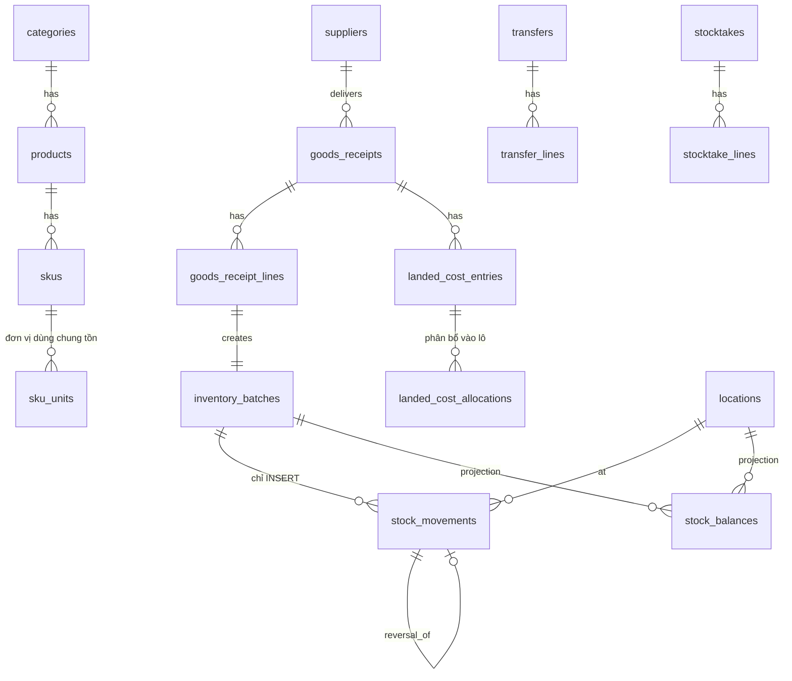
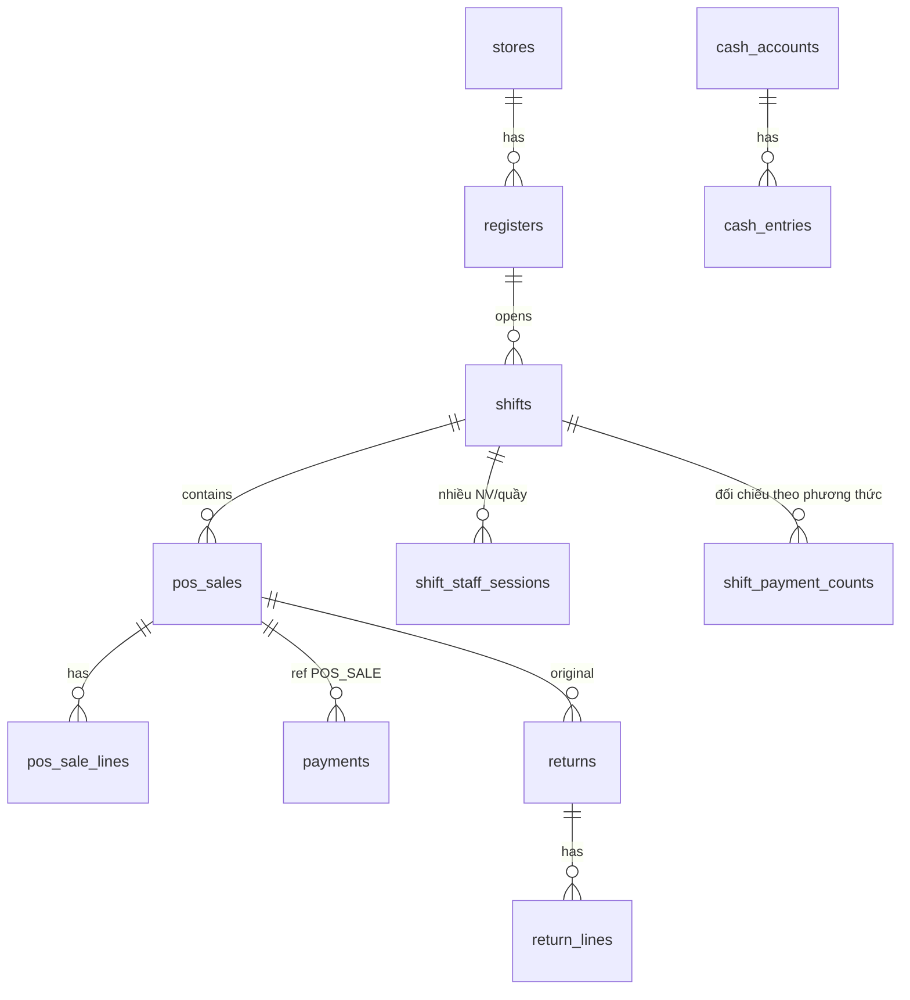
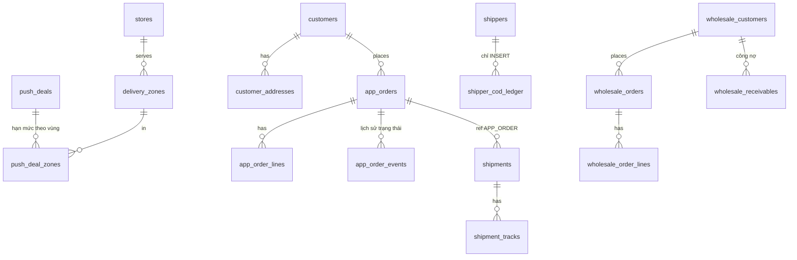

# ERD — Sơ đồ dữ liệu (CP01)

Nguồn: SPEC §12.1–§12.4, §10.5, §21.8 · ADR-003 (Prisma + `infra/sql`), ADR-005 (sổ kho), ADR-006 (schema/role/RLS),
ADR-007 (outbox/idempotency). Đây là **thiết kế**, chưa có migration chạy. Cột chi tiết lấy theo SPEC §12.2; bảng dưới
đây là danh mục đầy đủ + quan hệ chính + thứ tự migration.

## 1. Quy ước chung (§12.1)

- PK `id UUID` (UUID v7 sinh ở app; POS offline sinh `client_txn_id` v7). Bảng nối dùng PK ghép.
- Tiền `BIGINT` (`*_amount`, `*_price`, `*_per_kg`, `*_per_unit`); gram `INTEGER` (`*_g`); số đếm `INTEGER`
  (`*_units`); `CHECK (x >= 0)` trừ cột cho phép âm (đảo bút toán `qty_g`, `variance_*`, `rounding_amount`).
- `TIMESTAMPTZ` cho mốc thời gian (UTC); `business_date DATE` theo Asia/Ho_Chi_Minh, mốc 04:00.
- Danh mục: `archived_at` thay vì xóa. Chứng từ: cột chung `status, completed_at, completed_by, cancelled_at,
  cancelled_by, cancel_reason` (§21.3.2). Khóa lạc quan: `version INTEGER` trên đơn, tồn, mặt hàng đẩy.
- PII (`phone_enc`, `address_enc`, `receiver_phone_enc`, `totp_secret_enc`) = `BYTEA` mã hóa ứng dụng
  (`PII_ENC_KEY`); tra cứu bằng `*_hash` (HMAC với `PII_HASH_PEPPER`), index unique theo hash.
- Mã hiển thị `code` UNIQUE, sinh qua `code_sequences` (§21.3.14).

## 2. Danh mục bảng

Cột "Mig" = nhóm migration (mục 4). Module chủ = module NestJS duy nhất được ghi (ADR-002).

### 2.1. Schema `core` — §12.2 (76 bảng)

| Bảng | Module chủ | Quan hệ chính | Mig |
|---|---|---|---|
| users | auth | — | M02 |
| staff | auth | users | M02 |
| user_role_assignments | rbac | users; scope → stores/warehouses | M02 |
| approval_limits | rbac | — | M02 |
| sessions | auth | users, pos_devices | M02 |
| viewer_profiles | publish | store_ids[] → stores | M02 |
| viewer_profile_assignments | publish | users, viewer_profiles | M02 |
| stores | catalog (tổ chức) | — | M03 |
| warehouses | catalog (tổ chức) | — | M03 |
| locations | inventory | stores \| warehouses | M03 |
| registers | pos | stores | M03 |
| devices | pos | stores, registers | M03 |
| pos_devices | auth | stores, registers, users(activated_by) | M03 |
| categories | catalog | categories(parent) | M04 |
| products | catalog | categories | M04 |
| skus | catalog | products | M04 |
| store_prices | pricing | stores, skus | M04 |
| price_change_logs | pricing | skus | M04 |
| bundle_templates | catalog | skus | M04 |
| bundle_items | catalog | bundle_templates, skus | M04 |
| processing_recipes | catalog | skus | M04 |
| processing_recipe_inputs | catalog | processing_recipes, skus | M04 |
| suppliers | purchasing | — | M05 |
| goods_receipts | purchasing | suppliers, warehouses | M05 |
| goods_receipt_lines | purchasing | goods_receipts, skus, inventory_batches | M05 |
| landed_cost_entries | purchasing | goods_receipts, landed_cost_types | M05 |
| landed_cost_allocations | purchasing | landed_cost_entries, inventory_batches | M05 |
| supplier_returns | purchasing | suppliers, goods_receipts | M05 |
| supplier_payables | purchasing | suppliers, goods_receipts | M05 |
| inventory_batches | inventory | skus, suppliers, goods_receipt_lines; parent_batch_ids[] | M05 |
| stock_movements | inventory | locations, inventory_batches, skus; reversal_of_id → stock_movements | M06 |
| stock_balances | inventory | PK(location_id, batch_id, sku_id) | M06 |
| stock_reservations | inventory | locations, skus; ref_line_id đa hình | M06 |
| transfers | inventory | locations(from/to) | M06 |
| transfer_lines | inventory | transfers, inventory_batches, skus | M06 |
| stocktakes | inventory | locations | M06 |
| stocktake_lines | inventory | stocktakes, skus, inventory_batches | M06 |
| spoilage_logs | inventory | locations, inventory_batches | M06 |
| ripeness_checks | inventory | inventory_batches, locations | M17 |
| markdowns | pricing | inventory_batches, locations | M17 |
| processing_orders | inventory | processing_recipes, locations, inventory_batches(output) | M17 |
| processing_order_inputs | inventory | processing_orders, inventory_batches | M17 |
| shifts | pos | stores, registers, staff(cashier) | M07 |
| day_closes | pos | stores; UNIQUE(store_id, business_date, version) | M07 |
| cash_movements | pos | shifts, stores | M07 |
| pos_sales | pos | stores, registers, shifts; UNIQUE(client_txn_id) | M07 |
| pos_sale_lines | pos | pos_sales, skus, devices(scale), markdowns | M07 |
| payments | payments | ref_type/ref_id đa hình (POS_SALE\|APP_ORDER\|WHOLESALE) | M08 |
| refunds | payments | ref đa hình, files(proof) | M08 |
| unmatched_bank_txns | payments | — | M08 |
| customers | app-orders | users | M13 |
| customer_addresses | app-orders | customers, delivery_zones | M13 |
| customer_devices | notify | customers | M13 |
| store_follows | app-orders | customers, stores (dành cho H1 — hoãn) | M13 |
| delivery_zones | delivery | stores; `area geography(MultiPolygon,4326)` GIST | M13 |
| delivery_slots | delivery | delivery_zones | M13 |
| push_deals | push-deals | skus; batch_ids[] | M13 |
| push_deal_zones | push-deals | push_deals, delivery_zones | M13 |
| notifications_campaigns | notify | push_deals, files | M13 |
| notification_deliveries | notify | notifications_campaigns, customers, customer_devices | M13 |
| app_orders | app-orders | customers, delivery_zones, stores, delivery_slots | M14 |
| app_order_lines | app-orders | app_orders, push_deals, skus, files(scale_photo) | M14 |
| app_order_events | app-orders | app_orders (chỉ INSERT) | M14 |
| complaints | app-orders | app_orders, customers | M14 |
| shippers | delivery | users, stores | M15 |
| shipments | delivery | ref đa hình (APP_ORDER\|WHOLESALE), shippers | M15 |
| shipment_tracks | delivery | shipments | M15 |
| shipper_cod_ledger | delivery | shippers, shipments (chỉ INSERT) | M15 |
| wholesale_customers | wholesale | wholesale_price_lists | M16 |
| wholesale_price_lists | wholesale | — | M16 |
| wholesale_price_items | wholesale | wholesale_price_lists, skus | M16 |
| wholesale_orders | wholesale | wholesale_customers, locations | M16 |
| wholesale_order_lines | wholesale | wholesale_orders, skus | M16 |
| wholesale_receivables | wholesale | wholesale_customers, wholesale_orders (chỉ INSERT) | M16 |
| files | files | owner đa hình; UNIQUE(sha256) cảnh báo trùng (không chặn) | M02 |
| period_locks | publish | — | M12 |

### 2.2. Schema `core` — bổ sung §21.8 (20 bảng)

| Bảng | Module chủ | Quan hệ chính | Mig |
|---|---|---|---|
| units | catalog | — | M04 |
| sku_units | catalog | skus, units | M04 |
| sku_default_locations | inventory | stores, skus, locations | M04 |
| barcode_rules | catalog | — | M04 |
| code_sequences | (shared) | PK(doc_type) | M02 |
| landed_cost_types | purchasing | — | M05 |
| supplier_prices | purchasing | suppliers, skus | M18 |
| purchase_orders | purchasing | suppliers, warehouses | M18 |
| purchase_order_lines | purchasing | purchase_orders, skus | M18 |
| reorder_rules | inventory | locations, skus | M18 |
| internal_use_logs | inventory | locations, inventory_batches | M06 |
| store_lock_dates | publish | stores | M08 |
| staff_badges | auth | staff; `badge_code_hash` | M09 |
| shift_staff_sessions | pos | shifts, staff | M09 |
| shift_payment_counts | pos | shifts | M08 |
| returns | pos | pos_sales(original) | M09 |
| return_lines | pos | returns, pos_sale_lines | M09 |
| cash_accounts | pos | stores (nullable = văn phòng/ngân hàng) | M09 |
| cash_entries | pos | cash_accounts; ref đa hình | M09 |
| import_jobs | catalog | files | M04 |

Cột bổ sung §21.8: `inventory_batches.alert_date, stop_sell_app_date`; `stock_movements.reversal_of_id`; enum
`movement_type` thêm `INTERNAL_USE`, `OPENING_BALANCE`. Đơn điện thoại dùng `app_orders.channel = PHONE` (thêm cột
`channel` enum `APP|PHONE`).

### 2.3. Schema `reporting` (§12.3, §10.5)

| Bảng | Ghi | RLS viewer | Ghi chú |
|---|---|---|---|
| live_sales_hourly | projector_rw | có | không có cột giá vốn (NC-10) |
| live_sales_hourly_cost | projector_rw | viewer bị REVOKE | giá vốn theo giờ, chỉ Master đọc (NC-10) |
| live_store_status | projector_rw | có | |
| live_orders | projector_rw | có | `customer_masked`, không PII |
| live_stock | projector_rw | có | chỉ số lượng |
| daily_revenue | projector_rw | có | R03 |
| snapshots | API publish (owner function) | có | chỉ INSERT + chuyển status bằng function |
| snap_sales, snap_inventory, snap_purchase, snap_price_spread, snap_delivery, snap_pnl | API publish | có | chỉ INSERT (trigger) |
| standard_cost_matrix | Master | viewer bị REVOKE | |

Function `reporting.allowed_stores(profile_id uuid) RETURNS uuid[]` (SECURITY DEFINER, đọc bản sao hồ sơ trong
`reporting.viewer_profile_scopes` — **đề xuất thêm** để viewer không cần đọc `core.viewer_profiles`).

Đã quyết (NC-10, Tiến duyệt 2026-11-17): `live_sales_hourly` KHÔNG có `cogs_amount` (lệch §12.3 có chủ đích, vì FR-INV-11) →
giá vốn nằm ở `reporting.live_sales_hourly_cost`, chỉ `projector_rw` ghi, chỉ Master (`app_rw`) đọc; `viewer_ro` bị REVOKE.

### 2.4. Schema `audit`, `integration`

| Bảng | Ghi | Ghi chú |
|---|---|---|
| audit.logs, audit.login_logs, audit.export_logs, audit.viewer_access | audit_writer | chỉ INSERT (trigger + quyền) |
| integration.outbox | app_rw (INSERT), worker (UPDATE `published_at`, `attempts`) | ADR-007 |
| integration.processed_events | worker | PK(consumer, event_id) |
| integration.webhook_inbox | app_rw | UNIQUE(provider, external_id) |
| integration.external_calls | app_rw, worker | không lưu secret/token trong request/response |
| integration.idempotency_keys | app_rw | **thêm theo ADR-007**; PK(scope, key) |
| integration.sql_migrations | owner | **thêm theo ADR-003** |

## 3. Sơ đồ quan hệ chính

### 3.1. Danh mục, mua hàng, kho

### 3.2. POS & thanh toán

### 3.3. App, mặt hàng đẩy, giao hàng, sỉ

## 4. Thứ tự migration (chưa chạy)

Prisma tạo bảng theo nhóm; `infra/sql` chạy sau mỗi nhóm cần ràng buộc đặc biệt. Số `NNN` là đề xuất.

| Nhóm | CP | Prisma | infra/sql |
|---|---|---|---|
| M01 nền | CP02 | — | `001_extensions.sql` (postgis, pgcrypto) · `002_schemas.sql` · `003_roles.sql` (4 role + default privileges) · `004_raise_immutable.sql` |
| M02 người dùng, phiên, file, mã | CP03 | users, staff, sessions, user_role_assignments, approval_limits, viewer_profiles(+assignments), files, code_sequences, audit.*, integration.* | `010_audit_append_only.sql` · `011_integration_unique.sql` |
| M03 tổ chức | CP03/CP04 | stores, warehouses, locations, registers, devices, pos_devices | — |
| M04 danh mục | CP04 | categories, products, skus, units, sku_units, sku_default_locations, store_prices, price_change_logs, bundle_*, processing_recipe*, barcode_rules, import_jobs | — |
| M05 mua hàng & lô | CP05 | suppliers, landed_cost_types, goods_receipts(+lines), landed_cost_entries/allocations, supplier_returns, supplier_payables, inventory_batches | — |
| M06 sổ kho | CP06 | stock_movements, stock_balances, stock_reservations, transfers(+lines), stocktakes(+lines), spoilage_logs, internal_use_logs | `020_stock_movements_immutable.sql` · `021_stock_checks.sql` (kho tổng không âm) |
| M07 POS lõi | CP07 | shifts, day_closes, cash_movements, pos_sales, pos_sale_lines | `030_pos_client_txn_unique.sql` |
| M08 thanh toán, ca | CP08 | payments, refunds, unmatched_bank_txns, shift_payment_counts, store_lock_dates | `031_lock_date_guard.sql` |
| M09 POS mở rộng | CP09 | staff_badges, shift_staff_sessions, returns(+lines), cash_accounts, cash_entries | — |
| M10 reporting live | CP10 | reporting.live_*, daily_revenue | `040_reporting_grants.sql` |
| M12 snapshot, viewer | CP12 | reporting.snapshots, snap_*, standard_cost_matrix, period_locks | `041_snapshots_immutable.sql` · `042_viewer_rls.sql` · `043_allowed_stores_fn.sql` |
| M13 vùng giao, deal, thông báo | CP13 | customers, customer_addresses, customer_devices, store_follows, delivery_zones, delivery_slots, push_deals, push_deal_zones, notifications_* | `050_zones_gist.sql` (geography + GIST) |
| M14 đơn app | CP14 | app_orders(+channel), app_order_lines, app_order_events, complaints | `051_app_order_events_append_only.sql` |
| M15 giao hàng | CP15 | shippers, shipments, shipment_tracks, shipper_cod_ledger | `052_cod_ledger_append_only.sql` |
| M16 sỉ | CP16 | wholesale_* | `053_receivables_append_only.sql` |
| M17 độ chín, sơ chế | CP17 | ripeness_checks, markdowns, processing_orders(+inputs) | — |
| M18 PO, bổ sung | CP18 | supplier_prices, purchase_orders(+lines), reorder_rules | — |

Nguyên tắc: mỗi migration có rollback (`down`) hoặc ghi rõ phần không đảo được; không migration phá hủy dữ liệu khi
chưa có lệnh của Tiến.

## 5. Index & ràng buộc bắt buộc (§12.4 + đề xuất)

- `stock_movements(batch_id, location_id, created_at)`, `(business_date, location_id)`; trigger chỉ-thêm.
- `stock_balances` PK `(location_id, batch_id, sku_id)`; `CHECK` theo loại vị trí (kho tổng ≥ 0) qua trigger.
- `pos_sales(client_txn_id)` UNIQUE; `pos_sales(store_id, business_date)`.
- `push_deals`: cập nhật `sold_g` bằng `UPDATE … WHERE sold_g + $1 <= quota_g RETURNING` (không dựa Redis).
- `delivery_zones` GIST(area); `customer_addresses` GIST(location).
- `webhook_inbox` UNIQUE(provider, external_id); `processed_events` PK(consumer, event_id).
- `inventory_batches(sku_id, expiry_date)` cho FEFO; partial index `WHERE status = 'ACTIVE'`.
- `app_orders(store_id, status)`, `app_orders(customer_id, placed_at DESC)`.
